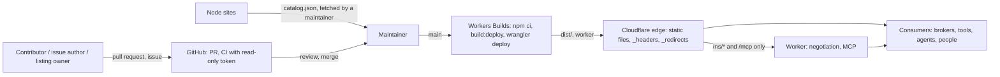

# Threat model — datamodels.jp (catalogue)

## 1.1 Header

- **Project**: datamodels.jp (geolonia/datamodels), a public, versioned,
  bilingual catalogue of JSON Schemas, JSON-LD contexts and RDFS vocabularies,
  served as static files from Cloudflare Workers, with a small Worker for IRI
  content negotiation and an MCP server.
- **Repository**: https://github.com/geolonia/datamodels
- **Version binding**: commit `e5542423e632dbe1232f688cbd1ad3c7dced41cf` on
  `main` (2026-10-14). The repository has no release tags, so the model is
  bound to the commit. A report against a later commit is triaged against the
  model as it stood at that commit, not against this model.
- **Date / author**: 2026-10-16, drafted for the maintainer, Daniel Kastl, who
  ratifies the claims in §1.18.
- **Generation metadata**: produced with AI assistance. Model/agent: Claude
  Opus 5.5 (`claude-opus-5-5`) in Claude Code; effort: session default.
  Skills used: the Alpha-Omega `threat-model` plugin, version 1.2.1 at commit
  `192fd60cd0afe8851128ce4c68ed68c174c11948` (orchestrator plus
  `threat-model-recon`, `threat-model-surface`, `threat-model-interview` in
  draft-first mode, `threat-model-authoring`, `threat-model-backtest`,
  `threat-model-sidecar`). No MCP servers were used. Ten questions were
  adapted from the first Geolonia pilot (Pointsman); the others were written
  for a data catalogue.
- **Reporting cross-reference**: a finding that violates a §1.11 claimed
  property is reported through GitHub's private vulnerability reporting for
  this repository, which is enabled, as the organisation's default
  `SECURITY.md` (geolonia/.github) asks. A finding that lands in §1.3 or §1.12
  is closed citing this document.
- **Status**: unratified draft, 2026-10-16. No maintainer answer has been
  recorded yet; the questions are in §1.18. Closure constraint: an
  **inferred** claim may escalate a report but never close it, and an
  **assumption** closes only what the triage policy below permits.
- **Triage policy**: `strict`. An **assumption** escalates and never closes.
  See §1.17.
- **Provenance legend**: *(documented, source)* = stated in the named public
  source of this repository; *(maintainer, YYYY-MM)* = confirmed by the
  maintainer in answer to this process; *(assumption, QN)* = a conservative
  default the author applies now, to be ratified by question `QN` in §1.18;
  *(inferred, QN)* = reasoned from code or configuration without a committed
  default, open as question `QN` in §1.18.
- **Glossary**: a short plain-language glossary is at the end of this document
  (Appendix A).
- **Draft confidence**: 201 documented / 0 maintainer / 40 inferred / 12 assumption.
  Counted as the plugin's validator counts, over §1.2 to §1.19: one count per
  parenthesised tag, by its first kind; the tags in this header and its legend
  are not counted.
- **Backtest note**: a 23-item corpus in 21 clusters, 2 real historical
  items and 21 synthesized. The real items are the two fixed cache-header
  defects found in the repository's history; there are no advisories, no
  issues labelled security, and the issues closed as not planned are feature
  decisions, not reports. The cases cover all six in-scope families and the
  out-of-scope toolkit. Dispositions: 5 `VALID`, 6 `KNOWN-NON-FINDING`
  (closed), 8 `BY-DESIGN: property-disclaimed` (4 closed, 4 escalated on
  Q9, Q16, Q17, Q22), 1 `OUT-OF-MODEL: dependency-contract` (escalated, Q11),
  1 `OUT-OF-MODEL: unsupported-component` (escalated, Q1), 2 `MODEL-GAP`
  (the unresolved rows of Q13 and Q19), 0 `VALID-HARDENING`. Fail-safe figure:
  0 of 2 historically-fixed items route to a closing disposition; both route
  `VALID` against `P-HEADERS`. 10 of 23 close outright, each licensed by a
  **documented** claim. No contradictions with a historical call. The routing
  table is producer-side (`.threat-model/backtest.md`, ignored by git), as the
  skill asks; the figures here are the only published part.
- **Sibling models**: `datamodels-toolkit` (geolonia/datamodels-toolkit, the
  `datamodels` CLI, its GitHub Action and the generic adapters) is modelled
  separately in its own repository. It has its own release cadence and a
  different adversary (it parses users' CSV, JSON and YAML and runs with a
  repository token). This model treats the pinned toolkit package as a
  dependency (§1.9).

datamodels.jp publishes data models for Japan as files at URLs that are meant
never to change. People and programs store those URLs in their data: type and
attribute IRIs, `@context` URLs, schema URLs. The catalogue is built from this
repository: anyone can send a pull request, maintainers review and merge it,
and Cloudflare Workers Builds deploys `main`. The catalogue stores no data of
its users, has no login and runs no service for data except a read-only MCP
server.

> **Triager quick-start.** Given an inbound finding:
> 0. Read the triage policy above (`strict`). It decides what an
>    **assumption** may do in step 8.
> 1. Locate the sink → look up its row in the §1.7 input-trust table (or the
>    §1.8 output statement, for "downstream may assume X" findings).
> 2. Locate the contract dimension → for numeric domain and representational
>    limits, failure/exception atomicity, recursive or cyclic topology,
>    callback/collaborator execution, serialization/reconstruction,
>    reference/object lifecycle, concurrency/reentrancy, resource complexity,
>    or the project-specific `x-version-immutability` and
>    `x-agent-instructions` dimensions, follow the component's row in the §1.7
>    matrix to its owning claim.
> 3. Check the required attacker capability and control kind against
>    §1.7/§1.10; distinguish data from size, resource name, code in the
>    repository and text meant for people or agents.
> 4. Check the affected component against §1.2/§1.3, and any required
>    configuration against §1.6.
> 5. If the root cause is in a dependency (Cloudflare, GitHub, npm packages,
>    the toolkit), apply §1.9.
> 6. Apply §1.17's precedence order, beginning with an exact §1.15 match.
> 7. Assign exactly one §1.17 disposition, citing the licensing section and its
>    provenance. If none fits, assign `MODEL-GAP` and trigger §1.16; do not
>    improvise.
> 8. **Before closing, check the provenance of the claim that licenses the
>    close.** This gate applies to every `OUT-OF-MODEL: *`, `BY-DESIGN: *` and
>    `KNOWN-NON-FINDING` route; `VALID` and `MODEL-GAP` are unaffected.
>    - **documented** or **maintainer** → close.
>    - **inferred** → **escalate, never close**, under either policy.
>    - **assumption** → escalate under `strict` (this model). Under `relaxed`
>      it licenses only a **provisional** close for `trusted-input`,
>      `adversary-not-in-scope`, `unsupported-component`,
>      `non-default-build` or a non-security-critical `property-disclaimed`.
>    - An **assumption** never closes `KNOWN-NON-FINDING`, a
>      security-critical `property-disclaimed` or `dependency-contract`.
>    - A disclaimer that rests on the **absence** of a statement never closes a
>      security-critical report, whatever its tag. §1.12 marks the basis of
>      each disclaimer.
>    Record the outcome as `closed`, `provisional` or `escalated` (§1.17). An
>    escalated finding keeps its disposition; it is not a `MODEL-GAP`.

## 1.2 Scope and intended use

datamodels.jp is used in three ways *(documented, README first paragraph: "usable as plain JSON, as linked data, and as they are with NGSI-LD brokers")*:

- **Referenced from stored data.** An NGSI-LD entity or a JSON-LD document
  names a catalogue `@context` URL, and its types and attributes expand to
  IRIs under `https://datamodels.jp/ns/`. The data depends on those URLs for
  as long as it is kept *(documented, docs/design.md "Decision 1": "every IRI under `datamodels.jp` that someone stores must resolve for the lifetime of their data")*.
- **Read by tools.** Brokers, converters, validators and AI agents read
  `catalog.json`, the schemas, contexts, vocabularies, examples, mapping files
  and adapter files *(documented, docs/design.md "Goals" item 5: "A machine-readable index (`catalog.json`) for brokers, tools and agents")*.
- **Read by people**, on the generated model pages in Japanese and English.

The project is a static publication plus two small dynamic paths. It is not a
library, not a broker and not a data store.

### Roles

- **Consumer (integrator).** Anyone who fetches a published file or stores a
  catalogue IRI: brokers, tools, agents, people. Consumers hold no credential.
  They are the party this contract is written for.
- **Contributor.** Anyone who sends a pull request, including from a fork, or
  a tool's "proposal bundle" sent by a person *(documented, CONTRIBUTING.md "Proposing a model that a tool made": "Tools never post")*. Untrusted until a maintainer merges.
- **Issue author** and **listing owner.** Anyone who opens an issue form; the
  owner of a listed extension; the operator of a node site in `nodes.yaml`.
  Their text reaches the catalogue only through a reviewed pull request.
- **Maintainer.** Reviews and merges; runs `npx datamodels release` and
  `npm run nodes`. Trusted *(documented, CONTRIBUTING.md "Stages and who decides": "Maintainers review and merge ordinary pull requests")*.
- **Operator.** Geolonia, which owns the domain, the Cloudflare account and
  the Workers Builds settings *(documented, docs/design.md "Decision 1": "Zone and Worker: Geolonia's Cloudflare account")*. Trusted.

### Component families

| Family | Representative entry point | Touches outside the process | In this model |
| --- | --- | --- | --- |
| `published-files` | `GET https://datamodels.jp/context/<subject>/vX.Y.Z.jsonld` and the other static files, with `public/_headers` and the generated `_redirects` | network (served by Cloudflare static assets) | in |
| `iri-negotiation` | `GET /ns/<subject>/<Term>` through `worker/index.mjs` | network; reads `catalog.json` through the assets binding | in |
| `mcp-server` | `POST /mcp` through `worker/mcp.mjs`, `worker/validate.mjs`, `worker/limit.mjs` | network; assets binding; the `MCP_LIMITER` rate-limit binding | in |
| `build-validation` | `npm run build:deploy`: `scripts/validate-models.mjs`, `scripts/lib/catalog-rules.mjs`, `scripts/build.mjs`, the adapters under `adapters/*/index.mjs`, and `datamodels check` from the pinned toolkit | filesystem (repository, `dist/`); network only in the online check (§1.5) | in |
| `listings` | `models/<subject>/<Type>/extensions/<name>.yaml`, `nodes.yaml` and `nodes.snapshot.json` (`npm run nodes`) | network when a maintainer runs `npm run nodes` | in |
| `supply-chain` | the pull-request path (`.github/workflows/*.yml`, DCO, branch rules), Workers Builds on `main`, the Cloudflare zone rules in `docs/deployment.md`, `wrangler.jsonc` | GitHub Actions runners; Cloudflare build environment and zone | in |
| `site-prose` | the VitePress pages under `site/` | network (served) | out, except where a page states a promise (§1.3) |
| `toolkit` | `npx @geolonia/datamodels` (`datamodels check`, `convert`, `release`) | filesystem, network | out: sibling model; a dependency here (§1.9) |
| `geonicdb-export-cli` | `node adapters/geonicdb/export.mjs` run by a user | filesystem | out (§1.3) |
| `dev-tools` | `test/`, `scripts/new-model.mjs`, `npm run site:dev`, `npm run dev` | filesystem | out (§1.3) |
| `node-sites` | the third-party sites listed in `nodes.yaml` | n/a | out (§1.3) |

The split into one model plus the toolkit sibling follows the principle that
a family with its own release cadence and adversary gets its own document
*(inferred, Q1)*.

## 1.3 Out of scope (explicit non-goals)

- **Runtime services for data.** The catalogue stores no consumer data, has
  no accounts and offers no write operation *(documented, site/en/ai.md "Using it from an agent": "It needs no login, only reads, and answers from the files of this site")*.
- **A general validation service.** `docs/design.md` lists "Runtime services
  (validation API, SPARQL, content negotiation) in 1.0.0" as a non-goal
  *(documented, docs/design.md "Non-goals")*. Since then, content negotiation
  on `/ns/*` (#196) and an MCP `validate` tool (#223) were added. This model
  treats both as in scope and reads the non-goal as superseded on those two
  points *(inferred, Q2)*.
- **Replacing Smart Data Models or running an ontology registry**
  *(documented, docs/design.md "Non-goals")*.
- **Hosting other people's extended models.** Extensions are listed, not
  hosted; their IRIs and contexts live on the owner's domain *(documented, CONTRIBUTING.md "Adding a listed extension" step 3: "the IRIs are not under datamodels.jp")*.
- **`site-prose`.** The prose of the pages is out of scope except where it
  states a promise to consumers. Those pages are cited where they do:
  `site/en/guide/urls.md` "The promises", `site/en/ai.md`. The generated model
  pages are an output of `build-validation` and are in scope as output (§1.8)
  *(inferred, Q1)*.
- **`toolkit`.** The `datamodels` CLI and its GitHub Action are the sibling
  model's job. Its `check` command is used here as a dependency of
  `build-validation`; a defect in it routes by §1.9 *(inferred, Q1)*.
- **`geonicdb-export-cli`.** `adapters/geonicdb/export.mjs` is a command a
  user runs on their own machine with their own arguments; it is not part of
  the build. The adapter module the build loads (`adapters/geonicdb/index.mjs`)
  is in scope as part of `build-validation` *(inferred, Q1)*.
- **`dev-tools`.** Tests and local-only commands do not run in the deployed
  catalogue. `scripts/dist-diff.mjs` and `scripts/check-languages.mjs` run in
  CI and belong to `supply-chain` *(inferred, Q1)*.
- **`node-sites`.** The sites in `nodes.yaml` are other people's catalogues.
  Only the reviewed snapshot of their index is in scope (`listings`)
  *(documented, nodes.yaml header comment: "so what they publish is reviewed before it appears on datamodels.jp")*.
- **The retired preview `models.geonicdb.com`.** It "must not answer"
  *(documented, docs/deployment.md: "`models.geonicdb.com`, the pre-launch preview, is retired and must not answer")*. A report that it still answers is an operator issue under §1.13, not a property of the catalogue.
- **Threats not defended against:** a compromised maintainer account, a
  compromised Geolonia Cloudflare, GitHub or AWS account, and a malicious
  platform (Cloudflare, GitHub, npm). These hold the keys to publishing; the
  model trusts them (§1.10).

## 1.4 Trust boundaries and data flow

There are three boundaries:

1. **Repository boundary.** Everything a contributor sends is untrusted until
   a maintainer merges it. CI runs the pull request's code with a read-only
   token and no secrets *(documented, .github/workflows/check-worker.yml header: "no Cloudflare token lives in GitHub")*. Merging is publishing: Workers Builds deploys `main`
   *(documented, docs/deployment.md: "Cloudflare Workers Builds watches this repository and deploys `main`")*.
2. **Build boundary.** Workers Builds runs `npm ci && npm run build:deploy`
   and `npx wrangler deploy` with the operator's deploy rights *(documented, docs/deployment.md: "build command `npm ci && npm run build:deploy`, deploy command `npx wrangler deploy`")*. Every package in the lockfile and every script in the repository at that commit runs on that side of the boundary.
3. **Edge boundary.** Consumers reach only Cloudflare. Static files are
   served without code of this repository; only `/ns/*` and `/mcp` run the
   Worker *(documented, wrangler.jsonc `assets.run_worker_first` comment: "No other path runs it")*.

Reachability preconditions:

| Family | A finding matters only if |
| --- | --- |
| `published-files` | it concerns bytes or headers that `https://datamodels.jp` serves for a URL in the URL scheme of `docs/design.md`, at a deployed commit |
| `iri-negotiation` | it is reachable with a request to a path under `/ns/` |
| `mcp-server` | it is reachable with one `POST /mcp` request of at most 64 KiB |
| `build-validation` | it is reachable from files a contributor can put in a pull request, and it changes what is published or lets a broken file through |
| `listings` | it is reachable from an extension file or a node's `catalog.json` and reaches a published page, `catalog.json` or an MCP answer |
| `supply-chain` | it lets someone without merge rights change what is deployed, or obtain a credential |

## 1.5 Assumptions about the environment

- **Runtime.** The Worker runs on Cloudflare Workers with
  `compatibility_date` 2026-08-01; static files are served by Workers static
  assets from `./dist` with `_headers` and `_redirects` *(documented, wrangler.jsonc "assets" block and comment "`_headers` and `_redirects` inside the directory set the URL contract")*.
- **Transport.** TLS terminates at Cloudflare for the custom domain, which
  `wrangler deploy` creates with its certificate *(documented, wrangler.jsonc "routes" comment: "deploying creates the DNS record and certificate")*.
- **Zone rule.** A configuration rule on the `datamodels.jp` zone turns off
  Browser Integrity Check for the machine-readable paths and `/mcp`. It lives
  in the Cloudflare dashboard, not in the repository *(documented, docs/deployment.md "Machine-readable files: no Browser Integrity Check")*.
  `npm run check:live` fails when it goes missing *(documented, docs/deployment.md: "`npm run check:live` fetches those paths with that user agent and fails if the rule goes missing")*. The check is run by hand after a deploy, not by CI *(inferred, Q23)*.
- **Domain.** `datamodels.jp` is registered in Route 53 in the GeonicDB AWS
  account, with name servers delegated to Cloudflare; `datamodel.jp` is held as
  a typo guard *(documented, docs/design.md "Decision 1": "Registration: Route 53 in the GeonicDB AWS account")*.
- **Build host.** Node 24 *(documented, package.json `engines`)*; Workers
  Builds and GitHub-hosted runners provide it. Workers Builds builds only
  branches of this repository *(documented, CONTRIBUTING.md "Pull request steps" step 5: "for branches in this repository also a preview URL")*.
- **Concurrency.** The Worker keeps per-isolate caches of public files (the
  MCP index, schemas, compiled validators, the subject majors). No state is
  shared between requests except these *(documented, worker/mcp.mjs header: "nothing is kept between requests except the catalog files, which are public")*.

### No-surprise side-effects inventory

| Effect | Stance | Components | Conditions | Provenance |
| --- | --- | --- | --- | --- |
| Outbound network from the Worker | absent | `iri-negotiation`, `mcp-server` | the Worker calls only `env.ASSETS.fetch` and the rate-limit binding. Search: `grep -n "fetch(" worker/*.mjs` — 4 hits, all `env.ASSETS.fetch` or the MCP SDK handler's `fetch` method | *(assumption, Q5)* |
| Storage writes from the Worker | absent | `iri-negotiation`, `mcp-server` | `wrangler.jsonc` declares no KV, D1, R2 or Durable Object binding; only `ASSETS` and `MCP_LIMITER` | *(assumption, Q5)* |
| Logs | present | `mcp-server`, `iri-negotiation` | `console.error` on internal failures and limiter errors; Cloudflare Workers observability is on (`"observability": { "enabled": true }`) and records invocations | *(assumption, Q21)* |
| Outbound network in the production build | absent | `build-validation` | Workers Builds runs `build:deploy`, which calls `datamodels check . --offline --all-released`; `npm ci` itself reaches the npm registry | *(assumption, Q5)* |
| Outbound network in the pull-request check | present | `build-validation`, `supply-chain` | `datamodels check . --base origin/<base> --all-released` (no `--offline`) fetches the live site, any remote `$ref` schema and any remote context it meets, from the GitHub runner | *(assumption, Q5)* |
| Outbound network by maintainer commands | present | `listings`, `supply-chain` | `npm run nodes` fetches every node index in `nodes.yaml`; `npm run check:live` fetches datamodels.jp | *(documented, scripts/fetch-nodes.mjs header: "read the catalog.json of every node in nodes.yaml")* |
| Child processes | present | `build-validation` | `scripts/build.mjs` spawns `scripts/validate-models.mjs`; the toolkit spawns `git` for `--base` | *(assumption, Q5)* |
| Code loaded from the repository at build time | present | `build-validation` | `scripts/lib/adapters.mjs` imports every `adapters/<name>/index.mjs` it finds | *(documented, scripts/lib/adapters.mjs header: "finds every adapters/<name>/index.mjs and loads its default export")* |

## 1.6 Build-time and configuration variants

| Knob | Default at the bound commit | Effect on the model | Support posture | Provenance |
| --- | --- | --- | --- | --- |
| `prerelease` in `node.yaml` | `true` | Exact versions get a 5-minute cache instead of a year; CI lists changed or removed release-snapshot files as notes instead of failures; voids `P-PUBLISHED-IMMUTABLE` until the official launch | supported until the launch; once `false` on the base branch it cannot be set back (the toolkit refuses it) | *(documented, README "Pre-release exception, until the official launch")* |
| `--offline` on `datamodels check` | used by `build:deploy` (production) and `validate:models` | skips the comparison with the live site and records a schema whose `$ref` points to another site as "not validated" (a note) | supported; the online comparison runs only in the pull-request check | *(documented, package.json `build:deploy` script)* |
| `--base origin/<base>` | used only in the pull-request job of `check-worker.yml` | compares release snapshots with the base branch | supported | *(documented, .github/workflows/check-worker.yml step "Compare the published versions with the base branch")* |
| Preview builds on workers.dev | on, branches of this repository only | same static tree and Worker; the zone's Browser Integrity Check rule does not apply; the same `MCP_LIMITER` namespace is declared again | supported for review, not for consumers | *(documented, wrangler.jsonc "previews" comment)* |
| `MCP_LIMITER` binding absent | present in production and previews | no rate limit (`allowed()` returns true) | dev-only (tests, `wrangler dev`) | *(documented, worker/limit.mjs `allowed` comment: "No binding (the tests; wrangler dev simulates it): no limit")* |
| `CHECK_MACHINE_UA=1` | unset | runs the user-agent checks of `check:live` against a preview too | dev-only | *(documented, docs/deployment.md "unless `CHECK_MACHINE_UA=1` is set")* |
| `run_worker_first` list | `["/ns/*", "/mcp"]` | which paths run code at all | supported; adding a path is a §1.16 trigger | *(documented, wrangler.jsonc `assets` comment)* |

No setting makes the published files private or adds authentication.

## 1.7 Assumptions about inputs

### Per-input-operand trust table

Coverage: every route that runs code (`/ns/*`, `/mcp`), the four MCP tools
and all their arguments, the static-file request, every file kind a pull
request can add under `models/`, `adapters/`, `scripts/`, `worker/`, the
package files, `node.yaml`, `nodes.yaml`, `nodes.snapshot.json`, and the
untrusted text the four workflows read. 41 rows. Not tabled: the VitePress
theme under `site/.vitepress/` (code a pull request can change; it is in the
same position as `scripts/` and covered by the row for repository code), and
the individual fields of `catalog.yaml`, `notes.yaml` and `ADOPTERS.yaml`
(covered by the rows for text and for self-reported data).

| Entry point | Input operand | Attacker-controllable? | Control kind | Caller must enforce | Provenance |
| --- | --- | --- | --- | --- | --- |
| static files `GET /<path>` | request path | **yes**, any client | resource-name | nothing; only files in `dist/` exist, anything else is the 404 page | *(documented, wrangler.jsonc `assets` "not_found_handling": "404-page")* |
| static files `GET /<path>` | request headers (Accept, User-Agent, Origin) | **yes** | data | nothing; static answers do not depend on them | *(documented, public/_headers header comment: "CORS is open for everything. Nothing here is private")* |
| `GET /ns/<subject>/<Term>` | path | **yes** | resource-name | nothing; only paths that `_redirects` answers with a 3xx are negotiated, subject matched by `^/ns/([a-z0-9-]+)/` | *(documented, worker/index.mjs header: "Only IRIs the catalog knows are answered that way: an unknown /ns/ path stays a 404")* |
| `GET /ns/<subject>/<Term>` | `Accept` header | **yes** | data | nothing; a tie goes to the page, wildcards are not counted | *(documented, worker/index.mjs `prefersJsonLd` comment: "a tie goes to the page")* |
| `GET /ns/<subject>/<Term>` | method | **yes** | data | nothing; only GET and HEAD are negotiated | *(documented, worker/index.mjs comment: "Only reads are negotiated; a preflight or a POST gets the static answer")* |
| `GET /ns/...` | `catalog.json` read through the assets binding | no — built from the reviewed repository | data | n/a | *(documented, worker/index.mjs comment: "The major version of each subject, from catalog.json")* |
| `POST /mcp` | method | **yes** | data | nothing; only POST and OPTIONS are served, other methods get 405 | *(documented, worker/mcp.mjs `handleMcp`: "send JSON-RPC messages with POST")* |
| `POST /mcp` | `Content-Length` and body bytes | **yes** | size | nothing; bodies over 64 KiB are refused while streaming (`MAX_BODY_BYTES`) | *(documented, worker/mcp.mjs `MAX_BODY_BYTES` comment: "The largest request body accepted")* |
| `POST /mcp` | `Content-Type` | **yes** | data | nothing; anything but JSON gets 415 | *(documented, worker/mcp.mjs `handleMcp`: "Content-Type must be application/json")* |
| `POST /mcp` | JSON-RPC message | **yes** | data, serialized-state | nothing; batches are refused, the message is parsed once | *(documented, worker/mcp.mjs header: "The body is parsed once, here: a batch is refused")* |
| `POST /mcp` | `MCP-Protocol-Version`, `Mcp-Session-Id` and other MCP headers | **yes** | data | nothing; the server is stateless, a session id selects nothing | *(documented, worker/mcp.mjs header: "Stateless and without login: each request gets a fresh server")* |
| `POST /mcp` | `cf-connecting-ip` | no — set by Cloudflare | data | n/a; it is the rate-limit key only | *(documented, worker/limit.mjs header: "There is no login, so the client's address is the only key")* |
| `search_models` | `query` | **yes** | data, size | nothing; 1–200 characters, matched against the index | *(documented, worker/mcp.mjs `registerTool('search_models')` input schema)* |
| `search_models` | `limit`, `include_nodes` | **yes** | size, data | nothing; `limit` 1–50 | *(documented, worker/mcp.mjs `registerTool('search_models')` input schema)* |
| `get_model` | `model` | **yes** | resource-name | nothing; resolved only against the index, never as a URL | *(documented, worker/mcp.mjs `findModel` comment: "The model a name stands for")* |
| `get_model` | `example`, `include_schema` | **yes** | data | nothing; closed enum and boolean | *(documented, worker/mcp.mjs `registerTool('get_model')` input schema)* |
| `find_attribute` | `query`, `limit` | **yes** | data, size | nothing; 1–200 characters, `limit` 1–50 | *(documented, worker/mcp.mjs `registerTool('find_attribute')` input schema)* |
| `validate` | `model` | **yes** | resource-name | nothing; resolved against the index; schemas outside `https://datamodels.jp/schema/` are refused | *(documented, worker/mcp.mjs `schema` comment: "A published schema of the catalog, by its URL")* |
| `validate` | `entity` | **yes** | data, size, object-topology | nothing; at most 1,000 keys per object and 64 levels, checked with an explicit stack | *(documented, worker/validate.mjs `shape` comment: "A walk with its own stack, so a deep entity cannot exhaust the call stack here")* |
| `validate` | `form` | **yes** | data | nothing; closed enum, detected when absent | *(documented, worker/mcp.mjs `registerTool('validate')` input schema)* |
| pull request | `models/<subject>/context.jsonld` | **yes**, contributor | data | review; CI checks coverage, imports and core terms | *(documented, docs/design.md "CI on every pull request validates")* |
| pull request | `models/<subject>/<Type>/schema.json` | **yes** | data, size, resource-name (`$ref`) | review of `$ref` targets, size and `pattern` expressions; CI checks examples against it | *(inferred, Q13)* |
| pull request | `examples/example.json`, `example-normalized.jsonld` | **yes** | data | review of content (real places, invented people); CI checks schema, NGSI-LD and JSON-LD round trip | *(documented, site/en/guide/rules.md "Real and fictional": "No personal names")* |
| pull request | `catalog.yaml`, `notes.yaml`, `README.md`, mapping notes | **yes** | data, x-agent-text | review of wording; markup escaped on pages | *(documented, scripts/lib/models.mjs `mdText` comment: "< and { become character references")* |
| pull request | `mapping/*.yaml` | **yes** | data, size | review; CI checks structure and that `via` does not loop | *(documented, README "Converting a published list": "the validator checks their structure")* |
| pull request | `ADOPTERS.yaml` | **yes** | data | the reviewer of a promotion to `stable` checks that adopters are real and independent | *(documented, docs/design.md "Versioning and lifecycle": "the reviewer of the promoting pull request checks that they are real and independent")* |
| pull request | `subject.yaml` version and `releases/vX.Y.Z/` snapshots | **yes** | data | maintainer runs `npx datamodels release`; CI compares snapshots with the base branch | *(documented, README "Adding or changing a model" step 3)* |
| pull request | `node.yaml` (`prerelease`, `baseUrl`, licence) | **yes** | data | review; the toolkit refuses `prerelease` going back to `true` or disappearing once the base branch has it | *(documented, CONTRIBUTING.md "Pull request steps" and README "Pre-release exception")* |
| pull request | `adapters/<name>/index.mjs` and other adapter code | **yes** | callback-code | review: the build imports it and runs it | *(documented, scripts/lib/adapters.mjs header: "loads its default export")* |
| pull request | `scripts/`, `worker/`, `site/.vitepress/`, `wrangler.jsonc` | **yes** | callback-code | review: CI runs it with a read-only token; after merge Workers Builds runs and deploys it | *(documented, .github/workflows/check-worker.yml steps "Test" and "Validate, build and dry-run deploy")* |
| pull request | `package.json`, `package-lock.json` | **yes** | callback-code, resource-name | review of dependency changes; `npm ci` installs exactly the lockfile | *(assumption, Q11)* |
| pull request | `extensions/<name>.yaml` | **yes**, listing owner via PR | data | review checks only that the reporter represents the organisation; CI checks form and plain text | *(documented, CONTRIBUTING.md "Adding a listed extension" step 4: "The content is listed as the owner reported it, without review")* |
| pull request | `nodes.yaml` | **yes** | resource-name | review; nodes are added only by a reviewed pull request | *(documented, scripts/fetch-nodes.mjs comment: "Nodes are listed only by a reviewed pull request (#219)")* |
| `npm run nodes` | a node's `catalog.json` | **yes**, node operator | data, size | maintainer reviews the snapshot diff; text reduced to plain text, URLs to plain http(s) | *(documented, scripts/lib/nodes.mjs `cleanText` comment: "Text from other sites ends up in Markdown pages (and Vue): plain text only")* |
| `check-languages.yml` | pull-request description (`PR_BODY`) | **yes** | data | passed as an environment variable, never into the script | *(documented, .github/workflows/check-languages.yml comment: "The description is passed as data in an environment variable")* |
| `similar-models.yml` | issue title and body | **yes**, any GitHub user | data | read from the event file as data; the job has `issues: write` | *(documented, .github/workflows/similar-models.yml header: "nothing from the issue reaches a shell command")* |
| `dist-diff.yml`, `check-worker.yml` | the pull request's merge commit | **yes** | callback-code | runs with `contents: read`, `persist-credentials: false` | *(documented, .github/workflows/check-worker.yml `permissions: contents: read`)* |
| Workers Builds | `main` at the merged commit | no — merged by a maintainer | callback-code | n/a | *(documented, docs/deployment.md: "deploys `main`")* |
| Workers Builds | dashboard settings (build and deploy commands, branch control) | no — operator | data | n/a | *(documented, docs/deployment.md "Dashboard settings on the `datamodels` Worker")* |
| zone | the Browser Integrity Check configuration rule | no — operator | data | n/a | *(documented, docs/deployment.md expression under "Machine-readable files: no Browser Integrity Check")* |
| consumer | the published files themselves, as input to the consumer's own processors | **yes**, from the consumer's point of view: written by contributors, reviewed by maintainers | data, size, resource-name | the consumer bounds its JSON-LD loader and schema validator (§1.13) | *(inferred, Q16)* |

### Size, shape and rate

- **MCP.** One request: at most 64 KiB of body, 1,000 keys per object, 64
  levels, 20 listed problems; entities with more than 250 values are checked
  stopping at the first error *(documented, worker/validate.mjs `FULL_CHECK_VALUES` comment: "250 values keep a full check to a few ms")*. 100 requests a minute per address (an
  IPv6 address by its /64), counted per Cloudflare location and approximately
  *(documented, docs/deployment.md: "100 requests a minute per client address, an IPv6 address by its /64, counted per Cloudflare location")*.
- **Static files.** No limit set by this repository; Cloudflare serves them.
- **Contributed files.** No size, nesting, `$ref` count or regular-expression
  limit is checked for schemas, contexts, examples or mapping files
  *(inferred, Q16)*.
- **Node indexes.** Text fields are cut to 200 characters on one line
  *(documented, scripts/lib/nodes.mjs `cleanText` comment: "plain text only, one line, not too long")*.

### Contract-dimension matrix

Status is `claimed`, `disclaimed`, `N/A — reason` or `unresolved`. Two
project-specific dimensions: `x-version-immutability` (does a published file
keep its bytes) and `x-agent-instructions` (text that an AI agent may read as
instructions).

| Component | Dimension | Status | Conditions / boundary | Routes to | Provenance |
| --- | --- | --- | --- | --- | --- |
| `published-files` | numeric domain and representational limits | claimed | versions are semantic versions; an alias `vX` points to the latest `X.y.z` | §1.11 `P-ALIAS-ADDITIVE` | *(documented, docs/design.md "URL scheme and hosting contract" item 6)* |
| `published-files` | failure and exception atomicity | disclaimed | a deploy replaces the whole tree; no guarantee about what a client sees during a deploy | §1.12 `D-NO-AVAILABILITY-SLA` | *(inferred, Q10)* |
| `published-files` | recursive or cyclic topology | disclaimed | a context imports other catalog contexts; nothing in the files guards a consumer's processor against deep import chains or large documents | §1.12 `D-CONTRIBUTED-FILE-LIMITS` | *(inferred, Q16)* |
| `published-files` | callback and collaborator execution | N/A — static files run no code on the server | | §1.4 | *(documented, wrangler.jsonc `run_worker_first` comment)* |
| `published-files` | serialization and reconstruction | claimed | files are JSON, JSON-LD, YAML, CSV, SQL as labelled by `Content-Type` | §1.11 `P-HEADERS` | *(documented, docs/design.md "URL scheme and hosting contract" item 2)* |
| `published-files` | reference and object lifecycle | claimed | term IRIs keep their meaning and keep resolving; no `retired` status | §1.11 `P-IRI-RESOLVES`, `P-TERM-MEANING-STABLE` | *(documented, docs/design.md "URL scheme and hosting contract" items 3 and 4)* |
| `published-files` | concurrency and reentrancy | N/A — read-only files | | §1.5 | *(documented, public/_headers header comment: "Nothing here is private")* |
| `published-files` | resource complexity | disclaimed | no size or shape limit on what consumers download and process | §1.12 `D-CONTRIBUTED-FILE-LIMITS` | *(inferred, Q16)* |
| `published-files` | x-version-immutability | claimed | exact-version context, vocabulary and schema files, after the launch | §1.11 `P-PUBLISHED-IMMUTABLE`; before the launch §1.12 `D-PRERELEASE-CORRECTIONS` | *(documented, docs/design.md "URL scheme and hosting contract" item 1)* |
| `iri-negotiation` | numeric domain and representational limits | claimed | `q` values parsed as numbers; a non-finite value counts as 0 | §1.11 `P-NEGOTIATION-FALLBACK` | *(documented, worker/index.mjs `qualities` comment: "The quality (0 to 1) the Accept header gives each media type")* |
| `iri-negotiation` | failure and exception atomicity | claimed | any error falls back to the static answer | §1.11 `P-NEGOTIATION-FALLBACK` | *(documented, worker/index.mjs comment: "Any error below falls back to the static answer")* |
| `iri-negotiation` | recursive or cyclic topology | N/A — no recursive input | | §1.7 | *(documented, worker/index.mjs header)* |
| `iri-negotiation` | callback and collaborator execution | N/A — no caller-supplied code | | §1.7 | *(documented, worker/index.mjs header)* |
| `iri-negotiation` | serialization and reconstruction | N/A — reads only `catalog.json` from the build | | §1.7 | *(documented, worker/index.mjs comment: "from catalog.json (read once per isolate)")* |
| `iri-negotiation` | reference and object lifecycle | unresolved | the subject majors are cached per isolate; after a major release an isolate may send the old major's vocabulary until it is recycled | §1.18 Q19 | *(inferred, Q19)* |
| `iri-negotiation` | concurrency and reentrancy | claimed | one shared promise per isolate; a failed read is dropped and retried | §1.11 `P-NEGOTIATION-FALLBACK` | *(documented, worker/index.mjs `subjectMajor` (`.catch(() => { majors = null; ...`))* |
| `iri-negotiation` | resource complexity | claimed | linear in the length of the `Accept` header | §1.11 `P-NEGOTIATION-FALLBACK` | *(assumption, Q19)* |
| `mcp-server` | numeric domain and representational limits | claimed | 64 KiB, 1,000 keys, 64 levels, 200-character text arguments, `limit` 1–50 | §1.11 `P-MCP-BOUNDED` | *(documented, worker/mcp.mjs `validate` tool description: "The request may be at most")* |
| `mcp-server` | failure and exception atomicity | claimed | stateless: a failed request leaves nothing behind; a failed index or schema read is not cached | §1.11 `P-MCP-STATELESS` | *(documented, worker/mcp.mjs comment: "A failed read is not kept")* |
| `mcp-server` | recursive or cyclic topology | claimed | depth checked iteratively before validation; a stack overflow during validation is answered as "too large" | §1.11 `P-MCP-BOUNDED` | *(documented, worker/mcp.mjs `validate`: "shape() has bounded the depth")* |
| `mcp-server` | callback and collaborator execution | N/A — tool arguments are data; no caller code runs | | §1.7 | *(documented, worker/mcp.mjs `READ_ONLY` annotations and header)* |
| `mcp-server` | serialization and reconstruction | claimed | the entity is parsed as JSON once; an own `__proto__` key is passed on as data | §1.11 `P-MCP-BOUNDED` | *(documented, worker/mcp.mjs `validate` input schema comment: "a copy would drop an own \"__proto__\" key")* |
| `mcp-server` | reference and object lifecycle | claimed | caches hold only public files, per isolate | §1.11 `P-MCP-STATELESS` | *(documented, worker/mcp.mjs comment: "The catalog, read from the assets once per isolate")* |
| `mcp-server` | concurrency and reentrancy | claimed | a fresh server per request; nothing of one request is visible to another | §1.11 `P-MCP-STATELESS` | *(documented, worker/mcp.mjs header: "each request gets a fresh server from the factory")* |
| `mcp-server` | resource complexity | claimed | per-request CPU in milliseconds for bodies inside the limits; `uniqueItems` checked with a set, not pairwise | §1.11 `P-MCP-BOUNDED` | *(documented, worker/validate.mjs header: "so one anonymous request cannot use hundreds of milliseconds of CPU")* |
| `mcp-server` | x-agent-instructions | disclaimed | answers carry contributed and listed text unchanged; nothing filters instructions aimed at agents | §1.12 `D-AGENT-TEXT` | *(inferred, Q17)* |
| `build-validation` | numeric domain and representational limits | claimed | semantic versions per subject; every schema states `x-version` | §1.11 `P-EXAMPLES-CONFORM` | *(documented, scripts/lib/catalog-rules.mjs comment: "Every schema says its version")* |
| `build-validation` | failure and exception atomicity | claimed | validation runs before anything is written to `dist/`; a failure stops the build | §1.11 `P-EXAMPLES-CONFORM` | *(documented, scripts/build.mjs comment: "Validate before anything is published")* |
| `build-validation` | recursive or cyclic topology | claimed | a context that imports a missing catalog version fails; `via` cycles in mapping files fail | §1.11 `P-EXAMPLES-CONFORM` | *(documented, README "Converting a published list" and scripts/lib/catalog-rules.mjs comment: "what that URL really serves must exist")* |
| `build-validation` | callback and collaborator execution | disclaimed | adapter modules and scripts in the repository run with the build's rights; review is the only control | §1.12 `D-REPO-CODE-RUNS` | *(documented, scripts/lib/adapters.mjs header)* |
| `build-validation` | serialization and reconstruction | unresolved | remote `$ref` targets: not restricted by a rule; offline they are skipped with a note | §1.18 Q13 | *(inferred, Q13)* |
| `build-validation` | reference and object lifecycle | claimed | a published version without a snapshot fails `--all-released` | §1.11 `P-PUBLISHED-IMMUTABLE` | *(documented, README "Adding or changing a model" step 3: "`npm run check` fails if a snapshot differs from the sources or the current version has none")* |
| `build-validation` | concurrency and reentrancy | N/A — a single build process per run | | §1.5 | *(documented, scripts/build.mjs header)* |
| `build-validation` | resource complexity | disclaimed | no limit on the size of contributed files | §1.12 `D-CONTRIBUTED-FILE-LIMITS` | *(inferred, Q16)* |
| `listings` | numeric domain and representational limits | claimed | node text cut to 200 characters; versions `X.Y.Z` only | §1.11 `P-OUTSIDER-TEXT-PLAIN` | *(documented, scripts/lib/nodes.mjs `cleanText` comment)* |
| `listings` | failure and exception atomicity | claimed | a node that does not answer keeps its previous entry; the snapshot is written to a temporary file and renamed | §1.11 `P-OUTSIDER-TEXT-PLAIN` | *(documented, scripts/fetch-nodes.mjs header: "A node that does not answer keeps its previous entry")* |
| `listings` | recursive or cyclic topology | N/A — flat records | | §1.7 | *(documented, scripts/lib/nodes.mjs `nodeEntry`)* |
| `listings` | callback and collaborator execution | N/A — listings are data | | §1.7 | *(documented, scripts/lib/extensions.mjs header: "the catalog lists it so others can find it")* |
| `listings` | serialization and reconstruction | claimed | only known fields are kept; text and URLs cleaned | §1.11 `P-OUTSIDER-TEXT-PLAIN` | *(documented, scripts/lib/extensions.mjs comment: "plain text and plain URLs only")* |
| `listings` | reference and object lifecycle | disclaimed | a listed extension's IRIs and contexts are the owner's; the catalogue does not keep them resolving | §1.12 `D-LISTED-CONTENT-UNREVIEWED` | *(documented, CONTRIBUTING.md "Adding a listed extension" step 3)* |
| `listings` | concurrency and reentrancy | N/A — maintainer command, run once | | §1.5 | *(documented, scripts/fetch-nodes.mjs header)* |
| `listings` | resource complexity | claimed | 15-second timeout per node; text cut to 200 characters | §1.11 `P-OUTSIDER-TEXT-PLAIN` | *(documented, scripts/fetch-nodes.mjs `TIMEOUT`)* |
| `supply-chain` | numeric domain and representational limits | N/A — no numeric input | | §1.7 | *(documented, .github/workflows/check-worker.yml)* |
| `supply-chain` | failure and exception atomicity | unresolved | a red check does not block a merge by itself: no status check is required on `main` | §1.18 Q7 | *(inferred, Q7)* |
| `supply-chain` | recursive or cyclic topology | N/A | no recursive input | §1.7 | *(documented, .github/workflows/check-worker.yml)* |
| `supply-chain` | callback and collaborator execution | claimed | pull-request code runs only with read-only tokens; deploy rights exist only in Workers Builds on branches of this repository | §1.11 `P-NO-DEPLOY-CREDENTIAL-IN-GITHUB`, `P-CI-TOKENS-SCOPED` | *(documented, docs/deployment.md: "no credential lives in GitHub")* |
| `supply-chain` | serialization and reconstruction | claimed | untrusted text (issue, PR description) is read as data, never interpolated into a shell command | §1.11 `P-CI-TOKENS-SCOPED` | *(documented, .github/workflows/similar-models.yml header)* |
| `supply-chain` | reference and object lifecycle | N/A — no long-lived objects | | §1.7 | *(documented, .github/workflows/check-worker.yml)* |
| `supply-chain` | concurrency and reentrancy | N/A — GitHub and Cloudflare serialise runs | | §1.9 | *(documented, .github/workflows/dist-diff.yml `concurrency` block)* |
| `supply-chain` | resource complexity | N/A — runner time limits (5–15 minutes) bound every job | | §1.9 | *(documented, .github/workflows/check-worker.yml `timeout-minutes: 15`)* |

## 1.8 Assumptions and guarantees about outputs

| Output channel | Component | Taint | Downstream must not assume | Provenance |
| --- | --- | --- | --- | --- |
| Exact-version contexts, vocabularies, schemas | `published-files` | constrained: written by contributors, reviewed, validated by CI | that they were never changed before the launch; that they are signed | *(documented, README "Pre-release exception, until the official launch")* |
| Version aliases `vX.jsonld`, `vX.json` | `published-files` | constrained | that their bytes stay the same; they advance to the latest compatible version | *(documented, public/_headers comment: "Aliases (vN.jsonld) advance to the latest compatible version")* |
| Examples, mapping files, adapter files, `catalog.json`, `llms.txt`, `/mcp/index.json` | `published-files` | constrained | that they are versioned or immutable; adapter output "is regenerated on every build" | *(documented, docs/design.md "Adapters": "Adapter output is regenerated on every build and is not part of the release snapshots")* |
| `catalog.json` node and extension entries | `listings` | the owners' claims, cleaned to plain text | that the catalogue reviewed or endorses them; that an extension's domain belongs to the organisation named | *(documented, CONTRIBUTING.md "Adding a listed extension" step 3: "whether the domain is the owner's is not checked")* |
| Text fields (titles, descriptions, notes, mapping notes) in any file | `published-files` | as untrusted as the contributor who wrote them, after review | that the text is safe to render as HTML or to follow as instructions; on the catalogue's own pages `<` and `{` are escaped, elsewhere nothing is | *(inferred, Q17)* |
| Generated model pages | `build-validation` | contributor text with markup escaped; outsider text reduced to plain text | that a description is free of misleading links | *(documented, scripts/lib/models.mjs `mdText` comment)* |
| `/ns/*` 302 to the page, 303 to `/vocab/<subject>/v<major>.jsonld` | `iri-negotiation` | constrained: same-origin paths only | that the 303 target is an exact version; it is the alias | *(documented, worker/index.mjs header: "a 303 See Other to the subject's vocabulary (/vocab/<subject>/v<major>.jsonld)")* |
| MCP tool answers (`search_models`, `get_model`, `find_attribute`) | `mcp-server` | constrained: data from the build, including node entries | that they are instructions; that node entries are catalogue models (they carry `"source": "node"`) | *(documented, worker/mcp.mjs `search_models` description: "models of other sites that build on the catalog (\"source\": \"node\")")* |
| MCP `validate` answer | `mcp-server` | assembled: problem paths and messages are built from the caller's keys and values | that `valid: true` means safe, true, authorised or free of personal data; that the `@context` was checked; that the list is complete when `complete` is false | *(documented, worker/mcp.mjs `validate` description: "its @context is not checked")* |
| MCP error messages | `mcp-server` | assembled: echo the `model` or `query` argument (at most 200 characters) | that they are constant text | *(documented, worker/mcp.mjs `findModel`: "No model \"${q}\" in the catalog")* |
| Response headers | `published-files`, `iri-negotiation`, `mcp-server` | constrained | that CORS restricts anything; it is `*` everywhere | *(documented, public/_headers header comment)* |

## 1.9 Assumptions about dependencies

| Dependency | Relied on for | Violation triaged |
| --- | --- | --- |
| Cloudflare Workers static assets | serving `dist/` as built, applying `_headers` and `_redirects` | upstream (`dependency-contract`) *(documented, docs/design.md "Hosting")* |
| Cloudflare Workers Builds | building `main` with the configured commands; building previews only for branches of this repository; holding the deploy credential | upstream *(documented, docs/deployment.md "Dashboard settings")* |
| Cloudflare Rate Limiting binding | counting `/mcp` requests per key, approximately, per location | upstream *(documented, worker/limit.mjs `allowed` comment: "Cloudflare counts per location and approximately")* |
| Cloudflare zone (TLS, DNS, configuration rule) | the custom domain, its certificate and the Browser Integrity Check exception | upstream *(documented, wrangler.jsonc "routes" comment)* |
| AWS Route 53 (GeonicDB account) | keeping `datamodels.jp` registered | operator *(documented, docs/design.md "Decision 1")* |
| GitHub (repository, Actions, branch rules, DCO app) | holding `main`, running CI with the declared permissions, enforcing the branch rules | upstream *(documented, .github/dco.yml header)* |
| npm registry and `package-lock.json` | delivering the locked packages to CI and to Workers Builds | upstream; a malicious published package version is `dependency-contract` *(assumption, Q11)* |
| `@geolonia/datamodels` 0.3.14 (toolkit) | `datamodels check` (schemas, examples, JSON-LD, release comparison), the generic adapters, `ngsi` helpers in the Worker | sibling model; forwarded there *(documented, package.json `devDependencies` and CONTRIBUTING.md "Pull request steps" step 3)* |
| `@modelcontextprotocol/server` 2.2.0 | the MCP protocol handling | upstream *(documented, worker/mcp.mjs header: "Protocol: @modelcontextprotocol/server (the MCP SDK)")* |
| `@cfworker/json-schema` 4.1.1 | JSON Schema checks in the Worker | upstream *(documented, worker/validate.mjs header: "The JSON Schema validator is @cfworker/json-schema")* |
| `zod` 4.6.5 | MCP argument schemas | upstream *(documented, worker/mcp.mjs import and `modelArg`)* |
| `ajv`, `ajv-formats`, `jsonld`, `yaml`, `vitepress`, `wrangler` | validation and build in CI and Workers Builds | upstream *(documented, package.json `devDependencies`)* |
| ETSI NGSI-LD core context | the list of protected core terms (fixture) | upstream *(documented, scripts/lib/models.mjs `CORE_TERMS`)* |

Routing rule: a dependency that fails its own documented contract while this
project uses it as documented → `OUT-OF-MODEL: dependency-contract`, forwarded
upstream (or to the toolkit's model). This project using a dependency
against its contract → in-model. There is no vendored third-party code in the
published files or the Worker beyond what the build bundles from the lockfile
*(assumption, Q11)*.

## 1.10 Adversary model

The baseline deployment is the one production Worker on `datamodels.jp` and
its previews on workers.dev.

| Actor | In scope? | Capabilities held | Capabilities excluded | Goals | Provenance |
| --- | --- | --- | --- | --- | --- |
| Contributor (pull request, also from a fork; also a tool's bundle sent by a person) | yes | any file in the pull request, including scripts, adapter code, workflows, snapshots and `node.yaml`; code execution in CI with read-only tokens | merging; approving their own pull request; running code in Workers Builds from a fork; reading secrets | change a published file, slip in a file that harms consumers, obtain a credential | *(documented, CONTRIBUTING.md "Pull request steps")* |
| Issue author | yes | text of issues, including the model-proposal form read by `similar-models.yml` | code execution; the job's token | reach a shell or the `issues: write` token | *(documented, .github/workflows/similar-models.yml header)* |
| Listing owner (extension) and node operator | yes | the content of an extension file sent by pull request; the content of their node's `catalog.json` | changing catalogue files or IRIs; adding markup to pages; adding a node without a reviewed pull request | appear endorsed; inject markup or links | *(documented, scripts/lib/extensions.mjs header and nodes.yaml header)* |
| Anonymous HTTP client (consumers, scanners, AI agents, MCP clients) | yes | any request to `datamodels.jp` or a preview, from many addresses | writing anything; reading anything that is not public (there is nothing); bypassing Cloudflare | exhaust the Worker, find an open redirect, get a wrong IRI answer | *(documented, site/en/ai.md "It needs no login, only reads")* |
| Maintainer | no — trusted | merge, release, run `npm run nodes` | n/a | n/a | *(documented, CONTRIBUTING.md "Stages and who decides")* |
| Operator accounts and platforms (Geolonia's Cloudflare, AWS, GitHub; Cloudflare, GitHub, npm themselves) | no — trusted | everything that publishes | n/a | n/a | *(inferred, Q11)* |
| Network attacker between a consumer and Cloudflare | no | n/a | n/a | n/a | *(assumption, Q5)* |
| Author of text aimed at an AI agent (a contributor whose description contains instructions) | yes, as a contributor | text in model files that passes review | anything beyond the contributor's capabilities | steer an agent that reads the catalogue | *(inferred, Q17)* |

## 1.11 Security properties the project provides

Each property states its conditions, the violation symptom, the tier, its
provenance and what voids it. Only properties the project has written down
are listed; candidates that rest only on code are §1.18 questions.

- **`P-PUBLISHED-IMMUTABLE` — published exact versions never change and are
  never removed.** After the official launch, a context, vocabulary or schema
  file published at an exact version (`vX.Y.Z`) keeps its bytes and stays
  online *(documented, docs/design.md "URL scheme and hosting contract" item 1: "A published exact-version file never changes and is never removed")*. The
  site states the same promise to consumers *(documented, site/en/guide/urls.md "The promises" item 1: "A published versioned file is never changed or removed")*.
  Every published version has a snapshot in `models/<subject>/releases/`; the
  build fails when a snapshot differs from the sources or the current version
  has none, and the pull-request check fails when a snapshot file changed or
  disappeared compared with the base branch and the live site *(documented, README "Adding or changing a model" step 3)*.
  - Symptom: `integrity-bypass` (a consumer that fetched a version earlier gets
    different bytes now).
  - Tier: security-critical.
  - Covers: exact-version files under `/context/`, `/vocab/`, `/schema/`. Not
    examples, mapping files, adapter output, `catalog.json` or aliases
    (`D-UNVERSIONED-FILES`).
  - *Voided by*:
    - `prerelease: true` in `node.yaml` — `node.yaml:13`. While the base branch
      also has it, the toolkit's `--base` comparison turns every changed or
      removed snapshot file into a note (toolkit `src/build/published.mjs`,
      `compareWithBase`, the `corrections` branch). This is the documented
      pre-release exception (`D-PRERELEASE-CORRECTIONS`).
    - The production build compares nothing with the base branch or the live
      site: `build:deploy` runs `datamodels check . --offline --all-released` —
      `package.json:23`. Only the pull-request job runs `--base`.
    - A merge that does not wait for a green pull-request check. No status
      check is required on `main` at the bound commit, so the guard holds only
      if maintainers do not merge a red check *(inferred, Q7)*.
    - When the live site cannot be reached, the online comparison is skipped
      and the snapshot comparison with the base branch still runs
      *(documented, docs/design.md "URL scheme and hosting contract" item 1: "the pull request check still compares the snapshots with main")*.

- **`P-TERM-MEANING-STABLE` — a term IRI never changes meaning.** A breaking
  change mints a new IRI; the old one stays published and documented
  *(documented, docs/design.md "URL scheme and hosting contract" item 4)*.
  Upstream IRIs are never re-minted *(documented, docs/design.md "URL scheme and hosting contract" item 5)*.
  - Symptom: `wrong-output` (stored data expands to a different meaning).
  - Tier: correctness-only. It is an editorial promise kept by review and
    versioning, not by a check.
  - Voided by: nothing in code; review is the control. Search:
    `grep -rn "x-deprecated" scripts/lib/*.mjs` — the validator checks the
    marker's form, not meaning.

- **`P-ALIAS-ADDITIVE` — within a major version, an alias only gains terms.**
  Data names the alias `vX.jsonld`; within a major version a term's meaning
  never changes, so data only gains new terms *(documented, docs/design.md "URL scheme and hosting contract" item 6)*.
  - Symptom: `wrong-output`. Tier: correctness-only. No switch affects it.

- **`P-IRI-RESOLVES` — catalogue IRIs keep resolving.** Every IRI under
  `datamodels.jp` that someone stores must resolve for the lifetime of their
  data *(documented, docs/design.md "Decision 1")*. A browser gets the
  documenting page; a program asking for JSON-LD gets the subject's vocabulary
  *(documented, site/en/guide/urls.md "The promises" item 3)*. There is no
  `retired` status; a deprecated model stays published *(documented, docs/design.md "Versioning and lifecycle": "There is no `retired` status")*.
  - Symptom: `x-unresolvable-iri` (a stored IRI answers 404 or points at the
    wrong page).
  - Tier: correctness-only. It is a commitment of the operator, not a
    mechanism; an outage is not a breach of it *(inferred, Q10)*.
  - Voided by: loss of the domain or of the Cloudflare zone (§1.9).

- **`P-HEADERS` — every published file carries the contract's headers.**
  `.jsonld` as `application/ld+json`, schemas as `application/schema+json`,
  CORS open, a year-long immutable cache for exact versions after the launch and
  a short max-age for aliases and during the pre-release *(documented, docs/design.md "URL scheme and hosting contract" item 2)*.
  The exact-version cache rule is generated per file so that it is not joined
  with the glob rules *(documented, public/_headers header comment: "The Cache-Control for exact versions is therefore generated per file at build time")*.
  - Symptom: `wrong-output` (a consumer caches a correctable file for a year,
    or a processor rejects a file for its media type).
  - Tier: correctness-only.
  - Voided by: `prerelease` selects the short cache — `scripts/lib/cache.mjs:14`.

- **`P-CORE-TERMS-PROTECTED` — no catalogue context redefines an NGSI-LD core
  term.** The validator rejects a subject context that defines a core-context
  term, even with the same IRI *(documented, docs/design.md "Decision 2" rules: "Never redefine a protected term of the NGSI-LD core context")*.
  - Symptom: `bad-data-accepted`.
  - Tier: correctness-only *(assumption, Q15)*.
  - *Voided by*: nothing. The check is `scripts/lib/catalog-rules.mjs:24`. Search:
    `grep -rn "CORE_TERMS" scripts/lib/*.mjs` — defined in `models.mjs`, used
    in `catalog-rules.mjs` and `extensions.mjs`; no flag skips it.

- **`P-EXAMPLES-CONFORM` — what is published passed the catalogue's checks.**
  Before anything reaches `dist/`, every example validates against its schema,
  expands and compacts with the subject context and the core context without
  losing a key, and every attribute has a context term *(documented, docs/design.md "Repository layout": "CI on every pull request validates")*;
  the build stops on any failure *(documented, scripts/build.mjs comment: "a model with a missing example or an attribute that does not expand must never reach dist/")*.
  - Symptom: `bad-data-accepted`.
  - Tier: correctness-only. Validation shows conformance, not safety
    (`D-VALIDATE-NOT-ASSURANCE`).
  - *Voided by*:
    - offline, a schema whose `$ref` points to another site is not compiled and
      its examples are not validated; the toolkit records a note
      ("not validated") instead of a problem (toolkit `src/build/check.mjs`,
      the `loadSchema` option of `Ajv2020` and the `Unavailable` branch). The
      production build runs offline: `--offline` is passed at
      `package.json:23`. See Q13.

- **`P-NEGOTIATION-FALLBACK` — the IRI Worker is never worse than the static
  answer.** Only GET and HEAD for IRIs that `_redirects` already answers are
  negotiated; a client that ranks JSON-LD above HTML gets a 303 to the
  same-origin path `/vocab/<subject>/v<major>.jsonld`; anything else, and any
  error, gets the static answer *(documented, worker/index.mjs header and comment: "Any error below falls back to the static answer, so the IRIs are never worse off than without this script")*.
  - Symptom: `wrong-output` (wrong target) or `x-open-redirect` (a target off
    the origin).
  - Tier: correctness-only.
  - Voided by: nothing. The fallback is `worker/index.mjs:81`; the 303 target is
    built at `worker/index.mjs:68` from a subject matched by `[a-z0-9-]+`.

- **`P-MCP-NO-OUTBOUND` — the MCP server fetches nothing from another site.**
  The tools read only the built tree through the assets binding
  *(documented, worker/mcp.mjs header: "Nothing is fetched from another site")*.
  A schema URL outside `https://datamodels.jp/schema/` is refused.
  - Symptom: `x-ssrf` (a request makes the Worker fetch a URL the client
    chose).
  - Tier: security-critical.
  - *Voided by*: nothing. The refusal is `worker/mcp.mjs:96`. Search:
    `grep -n "fetch(" worker/*.mjs` — 4 hits: `env.ASSETS.fetch` in
    `index.mjs` and `mcp.mjs`, the `fetch` method of the exported handler, and
    the SDK handler's `fetch`; none takes a client-chosen URL.

- **`P-MCP-STATELESS` — one MCP request cannot see another's data.** Each
  request gets a fresh server; nothing is kept between requests except the
  public catalogue files *(documented, worker/mcp.mjs header: "Stateless and without login: each request gets a fresh server from the factory")*.
  - Symptom: `info-leak`.
  - Tier: security-critical.
  - Voided by: nothing. Search: `grep -n "new Map\|WeakMap" worker/mcp.mjs` —
    the caches hold the index, published schemas and compiled validators, keyed
    by the assets binding and model id.

- **`P-MCP-BOUNDED` — one MCP request does bounded work.** At most 64 KiB of
  body, no batches, 1,000 keys per object, 64 levels, 20 listed problems; large
  or very wrong entities are checked up to their first problems
  *(documented, worker/mcp.mjs `validate` tool description and worker/validate.mjs header: "so one anonymous request cannot use hundreds of milliseconds of CPU")*.
  - Threshold: a request inside these limits that uses more than tens of
    milliseconds of CPU, or that the Worker's CPU limit stops, is a bug; slow
    is not, and many requests from many addresses are not (`D-RATE-LIMIT-BEST-EFFORT`) *(inferred, Q20)*.
  - Symptom: `x-cpu-exhaustion`.
  - Tier: correctness-only *(inferred, Q20)*.
  - Voided by: nothing in code. The body cap is `worker/mcp.mjs:371` and the
    streaming check in `readBody`; batches are refused at `worker/mcp.mjs:380`.

- **`P-OUTSIDER-TEXT-PLAIN` — listed text cannot add markup to the
  catalogue's pages.** Extension files may hold only plain text and plain
  http(s) URLs without credentials *(documented, scripts/lib/extensions.mjs comment: "nothing in a file can add markup, a script or a template expression")*;
  text from node indexes is reduced to one plain line of at most 200 characters
  and URLs to plain http(s) URLs *(documented, scripts/lib/nodes.mjs `cleanText` and `cleanUrl` comments)*.
  - Symptom: `x-markup-injection` (HTML, a script or a Vue expression from a
    listing runs on datamodels.jp).
  - Tier: security-critical.
  - *Voided by*: nothing. The checks are `scripts/lib/extensions.mjs:19` and
    `scripts/lib/nodes.mjs:16`. Search:
    `grep -n "UNSAFE_TEXT\|cleanText\|cleanUrl" scripts/lib/extensions.mjs scripts/lib/nodes.mjs`.

- **`P-MODEL-TEXT-ESCAPED` — contributor text is escaped on the pages.** Text
  from model files is Markdown; outside code spans `<` and `{` become character
  references, so it is not read as an HTML tag or a Vue expression
  *(documented, scripts/lib/models.mjs `mdText` comment)*.
  - Symptom: `x-markup-injection`.
  - Tier: correctness-only, because the text is reviewed before it is published
    *(inferred, Q18)*.
  - Voided by: nothing. The escape is `scripts/lib/models.mjs:82`.

- **`P-NO-DEPLOY-CREDENTIAL-IN-GITHUB` — nothing in GitHub can deploy.** No
  Cloudflare token lives in GitHub; CI only runs a dry-run deploy; Workers Builds
  deploys `main` *(documented, docs/deployment.md: "no credential lives in GitHub")*.
  Workers Builds builds only branches of this repository *(documented, CONTRIBUTING.md "Pull request steps" step 5)*.
  - Symptom: `integrity-bypass` (someone without merge rights changes what
    datamodels.jp serves).
  - Tier: security-critical.
  - *Voided by*: nothing in the repository. Search:
    `grep -rn "secrets\.\|CLOUDFLARE" .github/workflows` — 0 hits.

- **`P-CI-TOKENS-SCOPED` — untrusted text in CI is data, and tokens are
  narrow.** Every workflow runs with `contents: read`; only `similar-models.yml`
  adds `issues: write` and reads the issue from the event file as data; the
  pull-request description is passed in an environment variable
  *(documented, .github/workflows/similar-models.yml header: "nothing from the issue reaches a shell command")*.
  - Symptom: `integrity-bypass` (an issue or a pull request gets the token to
    act).
  - Tier: security-critical.
  - *Voided by*: nothing. The permission lines are
    `.github/workflows/similar-models.yml:26` (`issues: write`) and
    `.github/workflows/check-worker.yml:17` (`contents: read`). Search:
    `grep -n "permissions\|: write" .github/workflows/*.yml`.

### Worked routing examples

| Reported | Sink | Attacker needs | Symptom | Routes to | Licensed by |
| --- | --- | --- | --- | --- | --- |
| An exact-version file that the pre-release may still correct is served with a year-long `immutable` cache | generated `_headers` rule | nothing; any consumer is affected | wrong-output | `VALID` | `P-HEADERS` |
| Scanner: `/ns/<subject>/<Term>` answers with a redirect, "open redirect" | `iri-negotiation` | any request | x-open-redirect | `KNOWN-NON-FINDING` **(closed)** | `KNF-NS-SAME-ORIGIN` |
| A `v1.0.0` context changed after it was first served, before the launch | `published-files` | a merged correction | integrity-bypass | `KNOWN-NON-FINDING` **(closed)** | `KNF-PRERELEASE-CORRECTION` |
| MCP `validate` says `valid: true` for an entity whose text holds a script; a consumer rendered it | `validate` answer | any MCP request | x-markup-injection downstream | `BY-DESIGN: property-disclaimed` **(closed)** | `D-VALIDATE-NOT-ASSURANCE` |

The third row also matches `D-PRERELEASE-CORRECTIONS`; the exact §1.15 match
fires first.

## 1.12 Security properties the project does *not* provide

The basis column says whether a disclaimer rests on a **stated** limit or on
**silence** (nothing promises it). A silence-based disclaimer never closes a
security-critical report (§1.17).

| ID | The project does not provide | Conditions / boundary | Tier | False friend? | Provenance |
| --- | --- | --- | --- | --- | --- |
| `D-PRERELEASE-CORRECTIONS` | immutability before the official launch | stated. While `prerelease: true`, the published files of a subject's current version, `v1.0.0` included, may be corrected in place; exact versions get a 5-minute cache. Older releases are corrected only by maintainer choice, not blocked by CI (Q4). Ends when the launch sets `prerelease: false` | security-critical | no | *(documented, site/en/guide/urls.md: "Do not reference them from production data before the launch")* |
| `D-UNVERSIONED-FILES` | stable bytes for files that have no version in their URL | stated. Examples, mapping files, adapter files, `catalog.json`, `llms.txt`, `/mcp/index.json`, pages and aliases change with any build | correctness-only | no | *(documented, docs/design.md "Adapters": "not part of the release snapshots"; public/_headers "Mapping files (YAML, RFC 9512). Not versioned")* |
| `D-NO-SIGNATURE` | signatures, published digests or any way to verify bytes except comparing with the release snapshot in the repository | silence. The hash manifest was retired on 2026-10-14 (#226); nothing replaced it for consumers | security-critical | no | *(inferred, Q9)* |
| `D-CACHE-HINT` | integrity from `Cache-Control: immutable` | stated. The header tells caches how long to keep a file; it proves nothing about its content | correctness-only | yes: a cache directive is not an integrity guarantee | *(documented, scripts/lib/cache.mjs header: "After the official launch exact versions never change, so they are cached for a year as immutable")* |
| `D-NO-AVAILABILITY-SLA` | uptime, a mirror, or atomic deploys | silence for uptime; stated for the mirror ("not needed for 1.0.0"). `P-IRI-RESOLVES` promises that IRIs are kept, not that every request succeeds | correctness-only | no | *(inferred, Q10)* |
| `D-NO-CONFIDENTIALITY` | confidentiality of anything served | stated. Every file and answer is public; CORS is open | correctness-only | no | *(documented, public/_headers header comment: "Nothing here is private")* |
| `D-NO-AUTHENTICATION` | authentication or per-client authorisation | stated. The MCP server and the files need no login | correctness-only | no | *(documented, site/en/ai.md: "It needs no login, only reads")* |
| `D-BIC-NOT-ACCESS-CONTROL` | bot protection on machine-readable paths and `/mcp` | stated. Browser Integrity Check is off there by a zone rule, so Python clients are not blocked | correctness-only | yes: BIC on the pages is not an access control either | *(documented, docs/deployment.md "Machine-readable files: no Browser Integrity Check")* |
| `D-RATE-LIMIT-BEST-EFFORT` | a hard or fair rate limit on `/mcp` | stated. 100 a minute per address or /64, per Cloudflare location, approximate; users of hosted connectors share their provider's addresses; a failing limiter lets requests through | correctness-only | yes: the limit is not a denial-of-service defence | *(documented, worker/limit.mjs `allowed` comment: "A failing limiter lets the request through, as the data is public and the tools only read")* |
| `D-VALIDATE-NOT-ASSURANCE` | any statement beyond schema conformance from validation (CI or MCP `validate`) | stated. `valid: true` means the JSON Schema and the listed NGSI-LD checks passed; the `@context` is not checked; nothing is said about safety for HTML, truth, authorisation or personal data | correctness-only | yes: "valid" is not "safe" | *(documented, worker/mcp.mjs `validate` description: "its @context is not checked")* |
| `D-PERSONAL-DATA-MARKER` | any handling of personal data | silence. `x-personal-data: true` marks an attribute; the toolkit checks only that the value is `true` or absent. The catalogue holds no data, and the marker does not say how data must be protected, stored or classified under any law; an attribute without it may still be personal data | security-critical | yes: a marker is not a protection | *(inferred, Q22)* |
| `D-CONTRIBUTED-FILE-LIMITS` | limits that protect a consumer's processor from a published file | silence. No limit on size, nesting, number of `$ref`s, depth of context imports, or the complexity of `pattern` expressions in schemas; review is the control | security-critical | no | *(inferred, Q16)* |
| `D-AGENT-TEXT` | filtering of text meant to steer AI agents | silence. Descriptions, notes and listings reach agents through `llms.txt`, `catalog.json` and MCP answers as written | security-critical | no | *(inferred, Q17)* |
| `D-LISTED-CONTENT-UNREVIEWED` | review or endorsement of listed extensions and node models | stated. Content is listed as the owner reported it; whether the domain is the owner's is not checked; the review only checks that the reporter represents the organisation | correctness-only | yes: "listed on datamodels.jp" is not "endorsed" | *(documented, CONTRIBUTING.md "Adding a listed extension" steps 3 and 4)* |
| `D-STATUS-NOT-REVIEW` | a security review behind `stable`, `ADOPTERS.yaml` or a DCO sign-off | stated. `stable` means two independent adopters; adopters are self-reported; the sign-off is an agreement to the DCO, not an identity check | correctness-only | yes | *(documented, docs/design.md "Versioning and lifecycle": "Entries are self-reported with a link")* |
| `D-REPO-CODE-RUNS` | isolation of the build from repository code | stated. Adapter modules and scripts run with the rights of the build (CI's read-only token; after merge, Workers Builds) | security-critical | no | *(documented, scripts/lib/adapters.mjs header)* |

Well-known attack classes for a catalogue of schemas and contexts that the
project leaves to the consumer:

- **Remote context loading.** A JSON-LD processor that fetches `@context`
  URLs at run time depends on the network and on whatever answers. The
  catalogue publishes contexts; it does not control how processors fetch them.
- **Remote `$ref` resolution.** A schema validator that follows `$ref`s to
  any host can be made to fetch URLs. Today every `$ref` in `models/` points
  to `https://datamodels.jp/schema/` or inside the same document; no rule
  keeps it that way (Q13).
- **Regular-expression denial of service.** A `pattern` in a schema runs in
  the consumer's validator.
- **Expansion blow-up.** Deep context imports and large documents cost a
  JSON-LD processor time and memory.
- **YAML aliases.** Mapping files are YAML; a parser that expands aliases
  without a limit can be made to allocate a lot.
- **Indirect prompt injection.** Text in a model can be read by an agent as an
  instruction.
- **Look-alike domains.** `datamodel.jp` is held as a typo guard; other
  look-alikes are not.

## 1.13 Downstream responsibilities

**Consumers (brokers, tools, agents, people storing IRIs):**

- Before the official launch, do not reference catalogue files from
  production data *(documented, site/en/guide/urls.md: "Do not reference them from production data before the launch")*.
- Name the alias `vX.jsonld` in stored data; use the exact version for audits
  and for reproducing a result *(documented, docs/design.md "URL scheme and hosting contract" item 6)*.
- Cache or bundle the contexts you depend on, and give your JSON-LD loader a
  timeout and a host allow-list; the catalogue offers no uptime guarantee
  (`D-NO-AVAILABILITY-SLA`) *(inferred, Q10)*.
- Treat schemas, contexts and mapping files as input to your own processors:
  limit `$ref` resolution to `https://datamodels.jp/`, bound the time your
  validator spends on `pattern`, and bound document size and import depth
  (`D-CONTRIBUTED-FILE-LIMITS`) *(inferred, Q16)*.
- Treat every text field as untrusted: escape it before rendering, and never
  let an agent act on it as an instruction (`D-AGENT-TEXT`) *(inferred, Q17)*.
- Decide yourself which attributes are personal data and how to protect them;
  `x-personal-data` is a hint (`D-PERSONAL-DATA-MARKER`) *(inferred, Q22)*.
- Validate your data with your own pipeline; the MCP `validate` tool is an aid
  for agents, and its answer is not an assurance (`D-VALIDATE-NOT-ASSURANCE`)
  *(documented, worker/mcp.mjs `validate` description)*.
- Ignore unknown fields in `catalog.json`; within a `formatVersion`, fields are
  only added *(documented, catalog.schema.json `description`: "consumers must ignore unknown fields")*.
- Treat node models (`"source": "node"`) and listed extensions as other
  people's claims (`D-LISTED-CONTENT-UNREVIEWED`) *(documented, CONTRIBUTING.md "Adding a listed extension" step 4)*.
- To verify bytes, compare with `models/<subject>/releases/vX.Y.Z/` in the
  repository; there is no signature (`D-NO-SIGNATURE`) *(inferred, Q9)*.
- Follow redirects from `/ns/*`: 302 to a page for browsers, 303 to the
  vocabulary for JSON-LD clients *(documented, site/en/guide/urls.md "The promises" item 3)*.
- Expect 429 from `/mcp` after 100 requests a minute from one address
  *(documented, docs/deployment.md "`/mcp` is rate-limited")*.

**Operator (Geolonia), for the claims above to hold:**

- Keep the zone's Browser Integrity Check rule and run `npm run check:live`
  after a deploy *(documented, docs/deployment.md: "After a deploy, run `npm run check:live`")*.
- Keep `datamodels.jp` registered and the zone in the same Cloudflare account
  *(documented, docs/design.md "Decision 1")*.
- Keep Workers Builds building `main`, with previews only for branches of this
  repository and `preview_urls` true *(documented, docs/deployment.md "`preview_urls` in `wrangler.jsonc` must stay `true`")*.
- Keep `RATE_LIMIT` in `worker/limit.mjs` equal to both `MCP_LIMITER`
  declarations *(documented, wrangler.jsonc `ratelimits` comment: "Keep \"limit\" equal to RATE_LIMIT")*.
- Keep `models.geonicdb.com` detached from the Worker *(documented, docs/deployment.md "`models.geonicdb.com` ... is retired and must not answer")*.
- At the launch, set `prerelease: false`; from then on, the pull-request check
  fails on any changed or removed published file *(documented, README "Pre-release exception")*.
- Merge only after the pull-request check is green while no status check is
  required *(inferred, Q7)*.

## 1.14 Known misuse patterns

- **Pinning a pre-release exact version for integrity.** Looks like: storing
  `v1.0.0` and its hash before the launch. Why unsafe: the current version
  may still be corrected. Instead: wait for the launch, or keep your own copy
  (`D-PRERELEASE-CORRECTIONS`) *(documented, README "Pre-release exception")*.
- **Fetching contexts on every request without a cache.** Looks like: a
  JSON-LD processor with the default network loader in a hot path. Why unsafe:
  availability and latency then depend on datamodels.jp. Instead: cache or
  bundle (§1.13) *(inferred, Q10)*.
- **Reading `valid: true` as "safe".** Looks like: storing or rendering an
  entity because the MCP tool or CI accepted it. Instead: escape and authorise
  in your own system (`D-VALIDATE-NOT-ASSURANCE`) *(documented, worker/mcp.mjs `validate` description)*.
- **Reading `x-personal-data` as a compliance statement.** Looks like:
  skipping a privacy review for attributes without the marker. Instead: decide
  per attribute (`D-PERSONAL-DATA-MARKER`) *(inferred, Q22)*.
- **Treating a listing as endorsement.** Looks like: trusting an extension's
  IRIs because the catalogue lists them. Instead: check the owner's domain
  (`D-LISTED-CONTENT-UNREVIEWED`) *(documented, CONTRIBUTING.md "Adding a listed extension" step 3)*.
- **Letting an agent follow catalogue text.** Looks like: an agent that reads
  a description through MCP and acts on an instruction in it. Instead: treat
  answers as data (`D-AGENT-TEXT`) *(inferred, Q17)*.
- **Using the alias for an audit.** Looks like: recording `v1.jsonld` as the
  definition used for a decision. Instead: record the exact version
  *(documented, docs/design.md "URL scheme and hosting contract" item 6: "The exact version is for audits")*.

## 1.15 Known non-findings (recurring false positives)

| ID | Components | Symptom / attack class | What gets reported | Conditions for an exact match | Discharged by | Provenance |
| --- | --- | --- | --- | --- | --- | --- |
| `KNF-CORS-WILDCARD` | published-files, mcp-server | CORS misconfiguration | "`Access-Control-Allow-Origin: *` on every response" | the response is a published file or an MCP answer; no cookie or credential is involved | `D-NO-CONFIDENTIALITY` | *(documented, public/_headers header comment: "CORS is open for everything. Nothing here is private")* |
| `KNF-MCP-NO-AUTH` | mcp-server | missing authentication | "the MCP endpoint accepts requests without a token" | the request uses one of the four read-only tools | `D-NO-AUTHENTICATION` | *(documented, site/en/ai.md: "It needs no login, only reads")* |
| `KNF-NS-SAME-ORIGIN` | iri-negotiation | open redirect | "`/ns/...` redirects, so it is an open redirect" | the `Location` is a same-origin path: the 303 to `/vocab/<subject>/v<major>.jsonld` or a 302 generated into `_redirects` from `models/` | `P-NEGOTIATION-FALLBACK` | *(documented, worker/index.mjs header: "Only IRIs the catalog knows are answered that way")* |
| `KNF-PRERELEASE-CORRECTION` | published-files | integrity change of a published file | "`/context/<subject>/v1.0.0.jsonld` changed after it was published" | `node.yaml` had `prerelease: true` on both the base branch and the change; the file belongs to the subject's current version | `D-PRERELEASE-CORRECTIONS` | *(documented, README "Pre-release exception, until the official launch")* |
| `KNF-RATE-LIMIT-SHARED` | mcp-server | rate-limit bypass or unfairness | "the limit can be exceeded from several locations or addresses" or "users of a hosted connector block each other" | the requests come from several Cloudflare locations, several /64 blocks, or one provider's shared addresses | `D-RATE-LIMIT-BEST-EFFORT` | *(documented, docs/deployment.md "Hosted connectors ... share a few addresses and one budget per Cloudflare location")* |
| `KNF-BIC-OFF` | published-files, mcp-server | missing bot protection | "Browser Integrity Check is disabled for `/context/`, `/schema/` and `/mcp`" | the path is in the zone rule's expression | `D-BIC-NOT-ACCESS-CONTROL` | *(documented, docs/deployment.md "Machine-readable files: no Browser Integrity Check")* |

## 1.16 Conditions that would change this model

Revise the model when any of these happens:

- The official launch: `prerelease` set to `false` in `node.yaml`. Re-bind the
  model to that commit; `D-PRERELEASE-CORRECTIONS` and
  `KNF-PRERELEASE-CORRECTION` stop applying.
- A path added to `run_worker_first`, a new MCP tool, or any login.
- A catalogue context that imports a context from another site (the planned
  profiles of upstream models import commit-pinned GitHub URLs), or the
  planned pinned mirror under `/context/mirror/`.
- A rule that restricts or allows `$ref` targets, or a size limit on
  contributed files.
- A published digest, signature or new manifest for consumers.
- Nodes read during the build instead of from the reviewed snapshot.
- A change of the deploy path: a deploy token in GitHub, Workers Builds
  building forks, or another host.
- A change of the branch rules on `main` (required checks, bypass).
- A new major version of the toolkit, or a change in how
  `datamodels check --base` treats published files.
- A change of domain or of the Cloudflare account.
- A report that cannot be routed to exactly one §1.17 disposition.

## 1.17 Triage dispositions

| Disposition | Meaning | Licensed by |
| --- | --- | --- |
| `VALID` | Violates a claimed property, via an in-scope adversary and input. | §1.11, §1.7, §1.10 |
| `VALID-HARDENING` | No §1.11 property violated, but the project makes a §1.14 misuse easy enough to harden. Private; maintainer discretion; usually no CVE. | §1.14 |
| `OUT-OF-MODEL: trusted-input` | Requires attacker control of an input marked trusted. | §1.7 |
| `OUT-OF-MODEL: adversary-not-in-scope` | Requires an excluded attacker capability. | §1.10 |
| `OUT-OF-MODEL: unsupported-component` | Lands in out-of-scope code. | §1.3 |
| `OUT-OF-MODEL: non-default-build` | Requires a §1.6 configuration marked dev-only or unsupported. Non-default alone is not enough. | §1.6 |
| `OUT-OF-MODEL: dependency-contract` | Root cause is a dependency failing its own contract; this project's use is conformant. Forward upstream. | §1.9 |
| `BY-DESIGN: property-disclaimed` | Concerns a property explicitly not provided. | §1.12 |
| `KNOWN-NON-FINDING` | Matches a documented recurring false positive. | §1.15 |
| `MODEL-GAP` | Fits none of the above. | triggers §1.16 |

Precedence (first matching rule wins):

1. An exact §1.15 pattern → `KNOWN-NON-FINDING`.
2. Unsupported component → `OUT-OF-MODEL: unsupported-component`.
3. Unsupported configuration → `OUT-OF-MODEL: non-default-build`.
4. Conformant use of a dependency that violated its own contract →
   `OUT-OF-MODEL: dependency-contract`.
5. Required control of a trusted input → `OUT-OF-MODEL: trusted-input`.
6. Required excluded attacker capability →
   `OUT-OF-MODEL: adversary-not-in-scope`.
7. Explicitly disclaimed property → `BY-DESIGN: property-disclaimed`.
8. Violated claimed property → `VALID`; otherwise an easy-to-prevent §1.14
   misuse may be `VALID-HARDENING`.
9. No unique supported conclusion → `MODEL-GAP`.

Closure constraint, all statuses: a disposition that closes a report against
the reporter (`OUT-OF-MODEL: *`, `BY-DESIGN: *`, `KNOWN-NON-FINDING`) must be
licensed by a **documented** or **maintainer** claim. An **inferred** claim
only escalates, under every policy. Under `strict` (this model) an
**assumption** also only escalates. Under `relaxed` an **assumption** may
license a provisional close for `trusted-input`, `adversary-not-in-scope`,
`unsupported-component`, `non-default-build` or a non-security-critical
`property-disclaimed`, never `KNOWN-NON-FINDING`, a security-critical
`property-disclaimed` or `dependency-contract`. A disclaimer that rests on the
absence of a statement never closes a security-critical report. `VALID` and
`MODEL-GAP` fail safe under every policy. An accepted model has zero
**inferred** and zero **assumption** claims.

Every closing disposition carries a status: `closed` (licensed by a
**documented** or **maintainer** claim), `provisional` (a `relaxed`-policy
**assumption** close; cite the `QN`, keep the §1.18 item open, re-open on
challenge) or `escalated` (the route is right but its claim cannot close yet;
hand to the maintainer with the intended disposition and the blocking `QN`).
Report both, as `DISPOSITION (status)`. An escalated finding is not a
`MODEL-GAP`.

## 1.18 Open questions for the maintainers

Draft-first mode: every question states the answer this draft already
applies. Answer them in one batch ("Q3 yes, Q9 no, because …"); a "yes"
promotes the matching tags to **maintainer**, dated with the month of the
answer. Waiting policy: the
model stays an unratified draft until the waves are answered, and is re-run
at the official launch in any case (§1.16).

**Wave 1 — scope, configuration, side effects**

- **Q1** — Is the scope right: one model for the catalogue with six families
  (`published-files`, `iri-negotiation`, `mcp-server`, `build-validation`,
  `listings`, `supply-chain`), the toolkit as a sibling model, and `site/`
  prose, the GeonicDB export CLI, tests and local tools, node sites and the
  retired `models.geonicdb.com` out of scope? Consumers are the integrators,
  contributors and listing owners are untrusted, maintainers and the operator
  are trusted.
  - Proposed answer: yes.
  - Lands in: §1.2, §1.3; licenses `OUT-OF-MODEL: unsupported-component` for
    the out-of-scope families.
- **Q2** — `docs/design.md` "Non-goals" still says no validation API and no
  content negotiation in 1.0.0, but `/ns/*` negotiation (#196) and the MCP
  `validate` tool (#223) exist. Is the code (with `site/en/guide/urls.md` and
  `site/en/ai.md`) the current contract, and the non-goal superseded on these
  two points?
  - Proposed answer: yes. The catalogue offers no general validation service
    with any service level; `validate` is an aid for agents, bounded and
    advisory (`D-VALIDATE-NOT-ASSURANCE`). Updating `docs/design.md` is a
    separate change.
  - Lands in: §1.3.
- **Q3** — `prerelease: true` is a supported production posture until the
  official launch, and consumers are told not to depend on exact versions
  before it. A report that a current-version file changed before the launch
  is `BY-DESIGN` / `KNOWN-NON-FINDING`, not `VALID`?
  - Proposed answer: yes.
  - Lands in: §1.6, §1.12 `D-PRERELEASE-CORRECTIONS`, §1.15
    `KNF-PRERELEASE-CORRECTION`.
- **Q4** — Before the launch, CI turns a change to **any** release snapshot
  into a note, not only to the current version's, while the README says only
  the current version is corrected. Is "older releases are never corrected"
  a rule that only review enforces, and is a change to an older release before
  the launch `VALID`?
  - Proposed answer: yes to both; the README rule holds, CI does not check
    it.
  - Lands in: §1.12 `D-PRERELEASE-CORRECTIONS` (boundary), §1.11
    `P-PUBLISHED-IMMUTABLE` (voided-by list).
- **Q5** — Side effects: the Worker fetches only through the assets binding
  and writes nothing; the production build is offline apart from `npm ci`;
  the pull-request check fetches the live site and any remote `$ref` or
  context from the runner; the build spawns only the validator and `git`;
  a network attacker between a consumer and Cloudflare is out of scope
  because TLS terminates at Cloudflare.
  - Proposed answer: yes.
  - Lands in: §1.5 inventory, §1.10.
- **Q6** — Reporting and coexistence: the repository has no `SECURITY.md`
  of its own; the organisation's default `SECURITY.md` and GitHub's private
  vulnerability reporting (enabled) are the channel; there is no earlier
  threat-model content to absorb.
  - Proposed answer: yes; the model sits alongside the organisation policy and
    replaces nothing.
  - Lands in: §1.1 reporting cross-reference; the back-map appendix.

**Wave 2 — integrity, permanence, supply chain**

- **Q7** — At the bound commit, `main` requires a pull request with one
  approval, the organisation's security-suite workflow and resolved threads,
  but no status check: the "Build and dry-run deploy" job, including the
  comparison of published versions, does not block a merge by itself, and the
  organisation ruleset allows bypass by a repository role and a team. Is it
  right that the immutability guard relies on maintainers not merging a red
  check, and that after the launch a merged change to a published file is
  `VALID` against `P-PUBLISHED-IMMUTABLE` however it got in?
  - Proposed answer: yes to both.
  - Lands in: §1.11 voided-by list, §1.7 matrix row `supply-chain` / failure
    atomicity, §1.13 operator.
- **Q8** — The immutability promise covers exact-version contexts,
  vocabularies and schemas only; examples, mapping files, adapter files,
  `catalog.json`, `llms.txt`, `/mcp/index.json` and aliases may change with
  any build.
  - Proposed answer: yes.
  - Lands in: §1.11 `P-PUBLISHED-IMMUTABLE`, §1.12 `D-UNVERSIONED-FILES`.
- **Q9** — Since the manifest was retired (#226), the catalogue publishes no
  digest or signature. Should that be a stated limit: "no signatures; the
  release snapshot in the repository is the reference copy"?
  - Proposed answer: yes, a stated disclaimer, tier security-critical.
  - Lands in: §1.12 `D-NO-SIGNATURE`, §1.13.
- **Q10** — `P-IRI-RESOLVES` is the operator's commitment that IRIs are kept
  and keep their meaning, not an uptime promise; outages and the moment of a
  deploy are not vulnerabilities; there is no mirror.
  - Proposed answer: yes; tier correctness-only; consumers cache.
  - Lands in: §1.11 `P-IRI-RESOLVES`, §1.12 `D-NO-AVAILABILITY-SLA`, §1.13,
    §1.14.
- **Q11** — Supply chain: Workers Builds runs `npm ci` and every locked
  package with the deploy rights; a malicious published package version is
  `OUT-OF-MODEL: dependency-contract`; there is no vendored code; Cloudflare,
  GitHub, npm and Geolonia's accounts are trusted; a dependency change is
  reviewed like code.
  - Proposed answer: yes.
  - Lands in: §1.9, §1.10, §1.7 row `package.json`.
- **Q12** — The CI token claims (`P-CI-TOKENS-SCOPED`) cover the four
  workflows in this repository; the organisation's security-suite workflow is
  run from `geolonia/.github` and is outside this model.
  - Proposed answer: yes.
  - Lands in: §1.11 `P-CI-TOKENS-SCOPED`, §1.3.

**Wave 3 — what a contributed file can do to a consumer**

- **Q13** — No rule restricts schema `$ref` targets. Today every `$ref` in
  `models/` points to `https://datamodels.jp/schema/` or inside the same
  file; offline, a remote `$ref` is skipped with a note; the MCP server
  refuses it. Choose: (a) claim "published schemas reference only catalogue
  schemas or local pointers", kept by review, correctness-only, so a merged
  external `$ref` is `VALID`; or (b) disclaim it and leave `$ref` resolution
  wholly to consumers.
  - Proposed answer: (a).
  - Lands in: §1.11 (new property) or §1.12; §1.7 row `schema.json` and matrix
    row `build-validation` / serialization.
- **Q14** — A catalogue context imports only catalogue contexts at a version
  that exists; CI refuses any other URL (`scripts/lib/models.mjs:69`). Should
  this be a claimed property, tier security-critical, because a context
  imported from another site lets that site change the meaning of stored
  data?
  - Proposed answer: yes; revisit when profiles of upstream models land
    (§1.16).
  - Lands in: §1.11 (new property `P-CONTEXT-IMPORTS-CATALOG`).
- **Q15** — Is `P-CORE-TERMS-PROTECTED` correctness-only? A redefinition of a
  protected core term makes a JSON-LD 1.1 processor fail rather than change
  meaning silently.
  - Proposed answer: yes, correctness-only.
  - Lands in: §1.11 `P-CORE-TERMS-PROTECTED`.
- **Q16** — No limit on the size or nesting of contributed files, the number
  of `$ref`s, the depth of context imports, or the complexity of `pattern`
  expressions. Should that be a stated limit, with bounding the consumer's
  processor a consumer responsibility?
  - Proposed answer: yes, a stated disclaimer, tier security-critical.
  - Lands in: §1.12 `D-CONTRIBUTED-FILE-LIMITS`, §1.13, §1.7.
- **Q17** — Text in model files and listings reaches agents through
  `llms.txt`, `catalog.json` and MCP answers unfiltered. Should "the
  catalogue does not filter instructions aimed at agents; agents treat
  answers as data" be a stated limit, with review as the only control?
  - Proposed answer: yes, stated disclaimer, tier security-critical.
  - Lands in: §1.12 `D-AGENT-TEXT`, §1.8, §1.10, §1.13, §1.14.
- **Q18** — Reviewed contributor text on the pages (`P-MODEL-TEXT-ESCAPED`)
  is correctness-only; outsider text from listings (`P-OUTSIDER-TEXT-PLAIN`)
  is security-critical because nobody reviews its content.
  - Proposed answer: yes.
  - Lands in: §1.11.

**Wave 4 — the Worker, MCP, personal data, operator rules, meta**

- **Q19** — The IRI Worker caches the subject majors per isolate; after a new
  major version an isolate may send JSON-LD clients to the old major's
  vocabulary until it is recycled. Its work is linear in the `Accept` header.
  Choose: disclaim the stale window as correctness-only, or claim that a 303
  always names the current major.
  - Proposed answer: disclaim, correctness-only.
  - Lands in: §1.7 matrix rows `iri-negotiation` / lifecycle and resource
    complexity, §1.12.
- **Q20** — `P-MCP-BOUNDED` is correctness-only, with the threshold "a request
  inside the limits that uses more than tens of milliseconds of CPU, or that
  the CPU limit stops, is a bug; slow is not".
  - Proposed answer: yes.
  - Lands in: §1.11 `P-MCP-BOUNDED`.
- **Q21** — Logs: the code logs only internal errors (`console.error`), never
  tool arguments or entities on purpose; Cloudflare Workers observability
  records invocations with request metadata such as the client address, kept
  for the plan's retention.
  - Proposed answer: yes; no other record of MCP use exists.
  - Lands in: §1.5 inventory.
- **Q22** — `x-personal-data: true` marks attributes that commonly hold
  personal data. It promises nothing about protection, storage, retention or
  legal classification, and an attribute without it may still be personal
  data. Should that be a stated limit?
  - Proposed answer: yes, stated disclaimer, false friend, tier
    security-critical.
  - Lands in: §1.12 `D-PERSONAL-DATA-MARKER`, §1.13, §1.14.
- **Q23** — The Browser Integrity Check rule, the Workers Builds settings and
  the custom domain are operator configuration outside the repository. A
  missing rule is an availability bug (correctness-only), not a security
  report; `npm run check:live` is run by hand after a deploy, not by CI;
  previews keep Cloudflare's default.
  - Proposed answer: yes.
  - Lands in: §1.5, §1.6, §1.13.
- **Q24** — Bind this model to commit `e554242`, keep the triage policy
  `strict`, and re-bind at the official launch.
  - Proposed answer: yes.
  - Lands in: §1.1, §1.16.

## 1.19 Machine-readable companions

`threat-model.yaml` (schema `threat-model-sidecar/v2`) and `threat-model.json`
(the plugin's `schema.json`, `spec_version` 1) sit beside this file at the
repository root. Authority order: prose > yaml > json. The YAML records the
SHA-256 of the exact prose bytes it was derived from; the JSON is a lossy
export bound only by commit and date and is never a triage input. Regenerate
both whenever this file changes. Two JSON fields are completed by hand after
export: `description` (the exporter takes the first paragraph of §1.2) and
`trust_boundaries` (the exporter cannot read §1.4 and labels every boundary
`inferred` with no text); the published JSON carries the §1.4 boundary for
each family with `documented` provenance, matching §1.4.

## Appendix: prior security-policy back-map

Not applicable — the repository has no `SECURITY.md` and no earlier document that states a threat model at the bound commit `e554242`; the organisation's default `SECURITY.md` describes only how to report, and the statements mined for this draft come from the README, `CONTRIBUTING.md`, `docs/design.md`, `docs/deployment.md`, `site/en/guide/urls.md`, `site/en/ai.md`, `wrangler.jsonc`, `public/_headers`, the workflow files and source-file comments, each cited inline.

## Appendix A: glossary

| Term | Plain meaning |
| --- | --- |
| Threat model | The written security contract between a project and the people who use it. Not a bug list; it describes the project as it is. |
| Consumer / integrator | Anyone who fetches a catalogue file or stores a catalogue IRI: a broker, a tool, an agent, a person. The model tells them which risks they own. |
| Triager | Whoever decides whether an incoming report is a real problem for this project, citing the section that justifies the call. |
| Disposition | The single bucket a report lands in after triage (§1.17). The set is closed. |
| Provenance tag | Who said so: **documented** (a public source in this repository), **maintainer** (confirmed in a question wave), **assumption** (a cautious default to be ratified), **inferred** (an open question). Only the first two can close a report. |
| Close / escalate | Closing tells the reporter "not a problem for us" and needs a documented or maintainer claim. Otherwise the report is escalated to the maintainer with the intended disposition. |
| IRI | The identifier of a type or attribute, such as `https://datamodels.jp/ns/transportation/RoadRestriction`. Stored data refers to it. |
| `@context` | A JSON-LD file that maps short names in data to IRIs. Changing it changes what data means. |
| Exact version / alias | `v1.0.0.jsonld` is an exact version, meant never to change; `v1.jsonld` is an alias that moves to the latest `1.x.y`. |
| Release snapshot | The copy of a published version's files in `models/<subject>/releases/`. CI compares against it. |
| Pre-release | The period before the official launch, while `prerelease: true`: the current version may still be corrected in place. |
| Node | Another site, built with the toolkit, that publishes data models and a `catalog.json`; listed in `nodes.yaml`. |
| Extension | Attributes another organisation added to a catalogue model under its own IRIs, listed with a YAML file. |
| MCP | Model Context Protocol, how AI agents call tools; `/mcp` offers four read-only tools. |
| Sink | The specific place input flows into: a request path, an MCP argument, a file in a pull request. |
| Control kind | What an attacker controls: the data, its size, a resource name, code in the repository, or text an agent may read (`x-agent-text`). |
| Security-critical / correctness-only | The tier of a property or disclaimer: whether a violation is a vulnerability or a bug. |
| False friend | Something that looks like a security guarantee but is not (an `immutable` cache header ≠ integrity; `valid: true` ≠ safe; `x-personal-data` ≠ protection). |
| Silence basis | A disclaimer written because nothing promises the property, rather than because the project stated a limit. It never closes a security-critical report. |
| Unratified draft | A model published while claims are unconfirmed. Usable, but it escalates rather than closes on the unconfirmed parts. |
